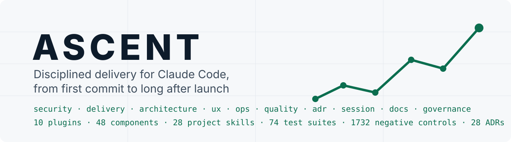
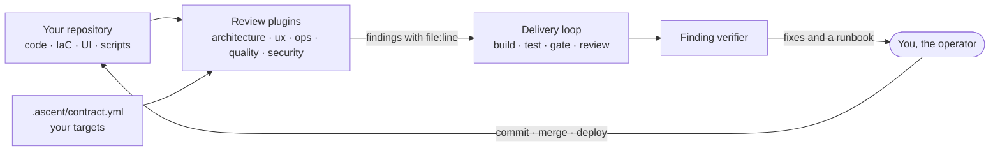

<h1>
<picture>
  <source media="(prefers-color-scheme: dark)" srcset="docs/assets/ascent-banner-dark.svg">
  
</picture>
</h1>

<p align="center">
  <a href="https://github.com/lloydbrian/lloydbriantech-ascent/actions/workflows/validate-skills.yml"></a>
  <a href="https://github.com/lloydbrian/lloydbriantech-ascent/releases"></a>
  <a href="#plugins-for-any-repository"></a>
  <a href="LICENSE"></a>
</p>

<p align="center">
  <a href="docs/framework/CAPABILITY-MAP.md">Capability map</a> ·
  <a href="#plugins-for-any-repository">Plugins</a> ·
  <a href="#quick-start">Quick start</a> ·
  <a href="#how-it-works">How it works</a> ·
  <a href="#scaffold-a-new-project">Scaffold</a> ·
  <a href="#status-and-roadmap">Roadmap</a> ·
  <a href="#documentation">Docs</a>
</p>

ASCENT is an opinionated engineering framework for [Claude Code](https://claude.com/claude-code). It turns the habits that keep software healthy for years into checks Claude can run: architecture against measurable targets, accessibility with WCAG evidence, operations that someone else can run, security baselines, and a delivery loop where Claude builds and verifies while you own every commit and deploy.

You can use it in two ways:

| Aspect | **Plugins** | **Parent skill** |
|---|---|---|
| For | Any repository, ASCENT or not | Starting, enhancing or migrating a project |
| You get | Review plugins, read-only by default, the delivery loop, and a launch-readiness check | A scaffolded project with 28 embedded `ascent-*` skills |
| Install | Two commands in Claude Code | `make install` from this repository |

## Why ASCENT

Most frameworks stop at the scaffold. ASCENT is for **what comes after**: the years in production when decisions turn into lore, documentation drifts from the code, and quality slips under fatigue, handoffs and deadlines. ASCENT turns those patterns into checks against your own targets, each finding tied to a file and line and rated from a fixed severity table. Every check serves one of four outcomes:

| Pillar | What the checks cover |
|---|---|
| **Business value** | Flows that work, quality attributes against measurable targets, tests that cover what matters, a delivery loop that ships |
| **Compliance** | WCAG 2.2 AA evidence, a dated accessibility law map, ADRs for every decision and waiver, waivers with review dates, dated review records and launch records a person signs, operations that pass an audit |
| **Trust and security** | Secrets, credentials, hardened containers, supply chain and vulnerability scans, and a hard line: Claude never commits or deploys |
| **Resilience** | Runbooks someone else can run, restore and failover proven by drill records, load tests held to latency and throughput targets |

[PILLARS.md](docs/framework/PILLARS.md) maps each quality attribute to the plugin or skill that checks it, the evidence it produces and the gaps that remain. The framework is built with its own rules: an ADR for every decision, phase-gated delivery and a gate of negative controls. [PHILOSOPHY.md](docs/framework/PHILOSOPHY.md) has the full rationale.

## Plugins for any repository

| Plugin | Version | Pillars | Ask Claude | What it does |
|---|---|---|---|---|
| [`ascent-security`](plugins/ascent-security/README.md) | 0.5.0 | Trust and security, compliance | "any secrets committed?", "are our dependencies safe?", "is our beta hardened?" | `.env` discipline, hardcoded credentials, container privilege, nginx headers, production URLs and dynamic code execution; lockfiles, pinning, sources, licences and an offline vulnerability scan of dependencies and local images; a STRIDE threat model; live checks the operator runs against local or beta, with ZAP, nuclei and dalfox; `check-env.sh`, which a project runs in CI to keep `.env` files out of git and out of images; plus a `security-auditor` agent |
| [`ascent-delivery`](plugins/ascent-delivery/README.md) | 0.3.0 | Business value, trust and security, resilience | "ship this change" | The delivery loop: decide, build with a file audit, test with negative controls, gate, independent review checked by a `finding-verifier`, and an operator runbook. A person accepts each change on beta, and prod stops until the acceptance record passes and, where the contract has a `governance` section, until the launch evidence is not a NO-GO. A hook blocks Claude from git writes and deploys |
| [`ascent-architecture`](plugins/ascent-architecture/README.md) | 0.2.3 | Business value, resilience | "is this production-ready?" | Quality attributes against measurable targets, design principles, deployment options with dated cost estimates, and a CloudFormation static-site blueprint |
| [`ascent-ux`](plugins/ascent-ux/README.md) | 0.3.3 | Compliance, business value | "is this UI accessible?", "do our flows work and keep the user's work?" | Flows that complete and hold up (broken links, dead ends, double submits, lost drafts, a cross-browser pass), WCAG 2.2 AA evidence from static checks and a Playwright browser pass, exact design-token contrast, and five accessible design directions shown as mocks |
| [`ascent-ops`](plugins/ascent-ops/README.md) | 0.3.2 | Resilience, compliance, trust and security | "is this operable?", "can we restore?" | Secure-by-design IaC configuration, zero-touch scripts and runbooks, Maintenance and Troubleshooting manuals proven current, and recovery drills and readiness exercises proven by the operator's records, plus an operable-service blueprint |
| [`ascent-quality`](plugins/ascent-quality/README.md) | 0.2.2 | Business value, resilience | "are we testing the right things?" | Which test types exist and whether CI runs them, which integration boundaries no test reaches, acceptance criteria and core rules traced to tests, test hygiene (focused, skipped, assertion-less and retried tests), load tests against the latency and throughput targets, and mutation evidence |
| [`ascent-adr`](plugins/ascent-adr/README.md) | 0.1.2 | Compliance, business value | "do our ADRs conform?", "write an ADR for this" | ADRs written in the repository's own format (ASCENT, Nygard and adr-tools, MADR) with real alternatives and costs; a record checked for sections, numbers, index, status, supersession both ways, dates, and accepted ADRs never rewritten, from git history; and the code checked against the constraints accepted ADRs declare |
| [`ascent-session`](plugins/ascent-session/README.md) | 0.1.0 | Business value, resilience | "where did we leave off?", "capture the session", "write a handoff" | Sessions resumed from the project's own records, every claim cited to its line; the session's state and decisions captured before closing; a handoff for the next person; and the records checked: decisions dated and only ever appended, personal state kept out of git, the handoff current |
| [`ascent-docs`](plugins/ascent-docs/README.md) | 0.1.2 | Business value, compliance | "are our docs current?", "do the docs still match the code?", "onboard me" | Documents reachable from the README and each persona's entry point, links and anchors that resolve, stale markers and lagging documents dated by git, the paths, make targets, scripts, variables, version and runtimes documents name checked against the repository, new documents from stubs, and an onboarding walkthrough |
| [`ascent-governance`](plugins/ascent-governance/README.md) | 0.3.0 | Business value, compliance | "are we ready for prod?", "which reviews are due?", "draft the launch record" | Launch readiness for one environment at a time (local, beta, prod, or your own ladder): GO, NO-GO or GO WITH CONDITIONS, every reason cited; a check that fails with only Medium or Low findings is a condition, not a NO-GO, and a checker that crashes is a NO-GO; each AI application has a risk tier a person signs, which scales every AI rule. The other plugins' checks run fresh, each review that needs judgement leaves a dated record with a maximum age, every waiver is listed with its ADR and review date, and the answer is a launch record that Claude drafts and only a person signs. `check-audit.sh` runs in your CI at no token cost, with a job summary and a one-file HTML page; plus a read-only `governance-conductor` agent |
| [`ascent-ai`](plugins/ascent-ai/README.md) | 0.1.0 | Business value, trust and security, resilience | "should this be an agent?", "do our evals prove it works?", "what does it cost per task?" | AI applications that earn their place: `ai-design` recommends the least autonomy that does the job (a single prompt, a fixed workflow, or an agent only when the steps cannot be known in advance) with its tools, limits, model and fallback, eval plan and off switch; checks you can run in CI hold the declarations to the code, the eval and retrieval results to their targets, and the running safeguards (tracing, a gateway with a budget, a cost-per-task alert) to the contract, every severity scaled by the application's risk tier, several applications per repository. Evidence only: it never runs a model, an eval or a network call; plus a read-only `ai-reviewer` agent |

Every review plugin but `ascent-session` has a read-only reviewer agent for delivery-loop reviews and second opinions. Not sure which to install? [Which plugins do I need?](docs/framework/OWNERSHIP.md#which-plugins-do-i-need) maps what your repository contains to the plugin that checks it. Each plugin works on its own, and one you have not installed leaves its review unmeasured, never blocked.

Every finding carries a plugin-qualified rule id, such as `OPS-S3` or `UX-D2`, so you can always tell which plugin raised it.

### What a run costs

Rough context-token ranges, so you know what to expect. They are estimated from file sizes (characters ÷ 4 for prose, ÷ 3.2 for code and tables, so expect ±25%), from script output measured on the test fixtures, and from modelled file reads. "Small" means about 30 source files and one core flow; "medium" means about 300 files, three flows and two browser engines. Your numbers depend mostly on how many files a review opens and on the browser pass.

| | Small repo | Medium repo |
|---|---|---|
| **Installed, every session** (skill and agent descriptions) | all ten plugins ≈ 6.2K; a scaffolded project's 28 skills ≈ 2.5K, plus its CLAUDE.md ≈ 1K | same |
| A focused check (`test-check`, `runbook-check`, `env-audit`, `doc-drift` …) | 5–9K | 10–23K |
| An entry review (`architecture-review`, `ops-review`, `quality-review`, `security-audit`, `dependency-check`, `adr-check`, `docs-review`) | 9–17K | 16–37K |
| Session records (`session-resume`, `session-capture`, `handoff`) | 3–6K | 5–12K |
| A launch-readiness check with every review current (`launch-readiness`, `governance-review`) | 6–10K | 8–14K |
| A UI review with the Playwright browser pass (`ux-review`, `flow-check`, `accessibility-audit`) | 27–52K | 110–190K (up to ~250K) |
| `design-directions` (six mocks, screenshots, a gallery) | 60–80K | 100–170K |
| `delivery-loop`, on top of the change itself | 16–25K | 25–40K |
| A reviewer agent (`*-reviewer`, `security-auditor`, `finding-verifier`) | 1–2.5K returned to you; it works in its own context | same |
| Parent skill `lloydbriantech-ascent` | 8–9K for a conventions question | ~20K for a multi-role feature |

The scripts print one line per rule or finding, usually under 1K tokens. A launch-readiness check runs the other plugins' scripts, which cost no tokens, and reads their one-line results; each review that is due adds that review's own cost, and `check-audit.sh` in CI costs none. The browser pass is the costly part: every page snapshot is 1–8K and every screenshot about 1K. To keep a UI review cheap, list fewer core flows and engines in the contract, or ask for the static checks only. Prefer the `*-reviewer` agents when you only need the verdict, since their reading stays out of your session. The descriptions are kept in full on purpose: they are what tells Claude, and you, when each skill applies (ADR-027).


## Quick start

In Claude Code (CLI, VS Code extension or desktop app):

```
/plugin marketplace add lloydbrian/lloydbriantech-ascent
/plugin install ascent-architecture@lloydbriantech-ascent
```

Install any of the ten the same way. Then ask in plain language, for example "review the architecture" or "is this operable?". Start with the reviews; add `ascent-delivery` when you want Claude to take changes from decision to a runbook you run.

> [!NOTE]
> While `ascent-delivery` is enabled, its hook blocks Claude from committing, pushing, tagging, merging and deploying in every session. That is the point: you run those steps from the runbook Claude writes.

## How it works



In words: the review plugins read your repository against the targets in your contract and report findings with `file:line`. The delivery loop fixes what the finding verifier confirms and writes a runbook. You run the commits, merges and deploys.

The plugins follow four patterns proven in the embedded skills ([patterns.md](skills/lloydbriantech-ascent/references/patterns.md)):

| Pattern | What it means | Example |
|---|---|---|
| Sibling | Skills that check overlapping areas read the same sources and never invoke each other | `env-audit` and `security-audit` |
| Hybrid aggregator | An entry-point review runs light surface checks and recommends a deeper skill only where one flags a concern | `ops-review` → `iac-config-check` |
| Detect, don't ask | A skill proposes its configuration from what the repository declares, then asks once to confirm | the contract proposal in the architecture, ux and ops reviews |
| Enumerate / summarize | One skill lists findings; a sibling rates the overall stance | `security-audit` and `sec-posture` |

A fifth, **conductor**, is a candidate with two uses: the delivery loop orchestrates reviewers and the verifier, and `ascent-governance` runs the other plugins' checkers and reads their review records, without doing their work.

## Scaffold a new project

The parent skill, `lloydbriantech-ascent`, starts new projects, enhances ASCENT projects and migrates others. It routes each request to one of nine engineering roles (delivery lead, architect, UI/UX designer, developer, data engineer, AI engineer, tester, devops, cybersecurity) and one of three modes (scaffold, enhance, migrate).

```bash
gh repo clone lloydbrian/lloydbriantech-ascent ~/Developer/repositories/lloydbriantech-ascent
cd ~/Developer/repositories/lloydbriantech-ascent
make install        # symlinks the skill into ~/.claude/skills/
```

Then, in an empty directory in Claude Code: *"Use lloydbriantech-ascent to scaffold this as my-new-project."* Claude asks a short set of questions and builds the project from the template, with slugs derived from the one name you give it.

```
my-new-project/
├── .ascent-meta.json              # project identity and phase
├── .claude/skills/ascent-*/       # 28 project-embedded skills
├── backend/                       # Express + SQLite (WAL), containerized
├── frontend/                      # React + Vite, containerized
├── docker-compose*.yml            # dev, prod and distribution stacks
├── nginx/                         # reverse proxy with security headers
├── Makefile + make/*.mk           # SDLC-sectioned operator vocabulary
├── docs/architecture/decisions/   # starter ADRs and an index
└── docs/delivery/                 # session state and working memory
```

`make dev-up` starts the stack; the API answers on `/-/health` and `/-/ready`.

> [!IMPORTANT]
> Scaffolding today is guided: Claude writes the project from the template. Scripted scaffolding (`scaffold.py` and friends, Phase 4) and a GitHub template repository (Phase 6) are on the [roadmap](docs/framework/ROADMAP.md) and not available yet.

<details>
<summary><strong>The 16 principles every ASCENT project holds</strong></summary>

| # | Principle | What it enforces |
|---|---|---|
| §1 | Containerization-first | The dev environment is the container; `make dev-up` from a bare host |
| §2 | Make as operator vocabulary | One `make` target per operation, the same name in dev, CI and runbooks |
| §3 | SDLC-sectioned help | `make help` groups targets by lifecycle stage |
| §4 | Stub-first naming | Future targets ship under their final name from the start |
| §5 | `.env` discipline | `.env` never committed; `.env.example` with empty defaults only |
| §6 | Strict backend layering | routes → controllers → services → storage; only storage writes |
| §7 | ADR discipline | Every constraining decision gets an ADR |
| §8 | Phase-gated delivery | Numbered phases, exit criteria, an explicit go-signal |
| §9 | Label-based scoping | Every container, volume and network carries the project label |
| §10 | Engine compatibility | Podman or Docker, detected; no hard-coded runtime |
| §11 | Context-aware execution | Skills adapt to the current phase and project state |
| §12 | Graceful shutdown | SIGTERM with a configurable grace period |
| §13 | Dev-status family | `make dev-status` reports containers, database and endpoints |
| §14 | Persona-segmented docs | Every doc names its reader; three clicks to anything |
| §15 | Session resumption | Working state and decisions survive across sessions |
| §16 | Behavior verification | Tests prove behavior, not that documentation mentions it |

Full text and rationale: [PRINCIPLES.md](docs/framework/PRINCIPLES.md).

</details>

<details>
<summary><strong>The 28 project-embedded skills</strong></summary>

**Baseline (always scaffolded):** `ascent-self-audit` · `ascent-layering-check` · `ascent-env-audit` · `ascent-observability-check` · `ascent-delivery-status` · `ascent-feature-intake` · `ascent-standup` · `ascent-adr-write` · `ascent-doc-stub` · `ascent-make-target` · `ascent-reflect` · `ascent-handoff` · `ascent-onboard` · `ascent-health`

**Specialized and conditional:** `ascent-data-health` · `ascent-doc-sweep` · `ascent-dependency-health` · `ascent-adr-conformance` · `ascent-skills-doctor` · `ascent-qa` · `ascent-release-readiness` · `ascent-security-audit` · `ascent-sec-posture` · `ascent-cost-posture` · `ascent-vitality` · `ascent-ai-evals` · `ascent-design-system-audit` · `ascent-persona-coverage`

Each has a behavior test that runs on macOS and Linux (`make test-skills`); negative controls in `make/mutants.tsv` prove 13 of those tests can fail, and the rest are on the list. The security skills also ship as the `ascent-security` plugin, generated from the same source ([ADR-009](docs/framework/DECISIONS/ADR-009-plugins-generated-from-template-skills.md)).

</details>

## Built to be trusted

Every plugin makes the same promises:

- **Read-only by default.** Reviews never edit your files. Skills that write, such as `ops-manuals` or `design-directions`, write only the files they name and never commit.
- **Evidence or it is not a finding.** Every finding cites `path/to/file:line`, or the paths searched when something is absent, plus a failure scenario and a fix.
- **Ratings from a table.** Each review plugin rates findings only from its severity table. For architecture, ux, ops, quality and dependency checks the gate checks that the skill's and the agent's copies match; the two other `ascent-security` rating skills share one table.
- **Your targets, not an ideal.** The project contract, `.ascent/contract.yml`, holds measurable targets for the architecture, ux, ops, quality and security plugins, the delivery loop's commands and acceptors (`ascent-delivery`, which still reads an older `.delivery-loop.yml`), and what each launch needs (`ascent-governance`). With no contract, those plugins propose one from what the repository declares and rates against enterprise defaults until you confirm it.
- **You own every write.** Claude never commits, pushes, tags, merges or deploys. It writes a numbered runbook and you run it; `ascent-delivery`'s hook enforces this.
- **No personal data.** Secret values, account ids and contact details never appear in a report.

Before release, every plugin clears the same bar:

1. Hardened source, with severity tables pinned by the plugin gate (`make test-plugins`).
2. Behavior tests for every script and rule (Principle §16), run on macOS and Linux; scripts also run under the stock macOS `/bin/bash` 3.2.
3. Negative controls (`make test-mutants`): every rule is broken on purpose, and a named test must fail.
4. A version bump for any change, enforced by `make/plugins.lock`, so installed copies always update.
5. A read-only trial on real repositories, with calibration rounds until the findings hold up.
6. A release record: CHANGELOG entry, ADR and tag.

## Status and roadmap

ASCENT is pre-1.0 and changes quickly; every change is recorded in the [CHANGELOG](CHANGELOG.md).

| | What | Status |
|---|---|---|
| **Now** | v0.4.27: the AI lifecycle (ADR-031): `ascent-ai` 0.1.0 checks AI applications by evidence, from the least autonomy that does the job to evals, tracing and spend; `ascent-governance` 0.3.0 adds a risk tier a person signs; `ascent-security` 0.5.0 adds red-team results and the AI threats; the hook blocks paid compute and GitHub writes through MCP tools; and `ascent-delivery` 0.3.0's `code-reviewer` gives the Code review lens an ASCENT reviewer (ADR-032). v0.4.26: `ascent-governance` 0.2.1 rates a floor checker that crashes with exit 2 as a crash, a NO-GO; the harness refuses both of its test-only variables; full mode gets 150 minutes a CI job, the harness group 240 (ADR-030). v0.4.25: faster negative controls, each running first the test that caught it last time, one test-suite baseline per group and scoped self-test reruns, with the same verdicts; `ascent-governance` 0.2.0 gives a check that fails with only Medium or Low findings GO WITH CONDITIONS (ADR-029). v0.4.24: `ascent-governance` 0.1.0, launch readiness for one environment at a time from fresh checks, dated review records, waivers with review dates and a launch record only a person signs; `check-env.sh` in `ascent-security` 0.4.0; "Recommended next" names the plugins a repository needs and the session lacks; the gate checks the framework's own release evidence (ADR-028). v0.4.23: three new plugins, `ascent-adr` 0.1.0 for decision records, `ascent-session` 0.1.0 for session continuity and `ascent-docs` 0.1.0 for documentation that can be found and stays true, with Decisions and Documentation lenses in `ascent-delivery` 0.2.1; the gate checks the framework's own ADRs (ADR-027). v0.4.22: `ascent-security` 0.3.0, live security testing the operator runs and a STRIDE threat model a person reviews (ADR-026). v0.4.21: faster local verification, with timings, the right test first, a cheaper rules test and a kill cache for local reruns (ADR-025). v0.4.20: `ascent-delivery` 0.2.0, a person's acceptance of each change, checked before prod (ADR-024); `ascent-ux` 0.3.1; a fresh scaffold that passes its own operations checks. CI runs what a change can affect (ADR-023), and the headline figures are checked like the [capability map](docs/framework/CAPABILITY-MAP.md) | ✅ Released |
| **Next** | Phase 4, scripted scaffolding, on its go-signal, and Phase 5 | Planned |
| **Later** | `ascent-node-stack`, last on the plugin roadmap, after Phase 5, scoped when it starts; Phases 6–7 | Planned |

| Release | Date | Highlights |
|---|---|---|
| v0.4.27 | 2026-11-25 | The AI lifecycle (ADR-031): `ascent-ai` 0.1.0, with `ai-design`, `ai-review`, three checkers (`AI-V`, `AI-M`, `AI-A`, `AI-P`, `AI-K`, `AI-F`, `AI-G`, `AI-E`, `AI-R`, `AI-L`, `AI-O`, `AI-C`) and the AI behavior lens; `ascent-governance` 0.3.0's AI risk-tier record (`GOV-A1`–`A5`), with the AI checks run per application; `ascent-security` 0.5.0's red-team results (`SEC-R1`–`R3`) and AI threats (`SEC-T5`); the operator-boundary hook blocks paid compute and GitHub writes through MCP tools. `ascent-delivery` 0.3.0's `code-reviewer` reads a change in seven passes and never posts, and the Correctness lens becomes Code review (ADR-032) |
| v0.4.26 | 2026-11-23 | A checker that crashes is a NO-GO (ADR-030): `ascent-governance` 0.2.1 reads a floor checker's exit 2 as a usage error, `GOV-S2` Medium, only when its first line is the checker's own message, and as `GOV-L1` High otherwise, with a behavior test that holds every adapted checker to the convention; the harness refuses `MUTANT_FAULT` from the environment and outside its own group, as it refuses `MUTANT_FULL`; the weekly full-mode run explains the jobs GitHub never started, and its control jobs get 150 minutes, the harness group 240 |
| v0.4.25 | 2026-11-20 | Faster negative controls with the same verdicts (ADR-029): fast mode runs first the test that caught each control last time, from the generated `make/mutant-order.tsv` (`make mutant-order FROM=<times file>`), and the times file records it; one baseline per group runs the behavior tests; the harness self-test scopes the full-mode reruns of its own by-design survivors, refused in any other group. `ascent-governance` 0.2.0: `GOV-L1` takes the checker's most severe finding, so a failing check with only Medium or Low findings gives GO WITH CONDITIONS at every environment and keeps a project's CI job green |
| v0.4.24 | 2026-11-20 | `ascent-governance` 0.1.0 (ADR-028): `launch-readiness` answers "are we ready for this environment?" with GO, NO-GO or GO WITH CONDITIONS; `check-audit.sh` runs each floor's checks fresh through one adapter table, reads the review log, every waiver and the launch record (`GOV-S1`–`S2`, `GOV-L1`–`L5`, `GOV-W1`–`W4`, `GOV-R1`–`R4`), and writes the record, a CI job summary and a one-file HTML page; `governance-review`, `review-record` and the `governance-conductor` agent. `ascent-security` 0.4.0 adds `check-env.sh` (`SEC-E1`–`E3`). `ascent-delivery` 0.2.2 checks the launch evidence before prod. "Recommended next" names missing plugins, from a generated copy of the registry. Gate check T17 asks the launch question of the framework itself |
| v0.4.23 | 2026-11-18 | Three plugins (ADR-027): `ascent-adr` 0.1.0 writes ADRs in the repository's own format and checks the record, `DEC-S1`–`S8` with accepted bodies compared to git history, and declared constraints, `DEC-C1`–`C3`; `ascent-session` 0.1.0 resumes, captures and hands off sessions from the repository's records, `SES-S1`–`S6`; `ascent-docs` 0.1.0 reviews documentation, `DOC-L1`–`L5`, `DOC-P1`–`P4`, checks what documents name, `DOC-R1`–`R6`, writes stubs (and `make doc-stub`) and walks a newcomer in. `ascent-delivery` 0.2.1 adds the Decisions and Documentation lenses. Gate check T16 runs `check-adrs.sh` on the framework's own ADRs; "What a run costs" gives token ranges |
| v0.4.22 | 2026-11-17 | `ascent-security` 0.3.0 (ADR-026): `security-test` writes the runbook for live checks the operator runs against local or beta (headers, TRACE and CONNECT, traversal, unauthenticated writes, oversized bodies, disclosure, a prompt-injection canary, an AI burst) and for ZAP, nuclei and dalfox in pinned containers, then rates the results (`SEC-L1`–`L10`); `threat-model` drafts a STRIDE model a person reviews (`SEC-T1`–`T4`) |
| v0.4.21 | 2026-11-16 | Faster local verification (ADR-025): the controls' summary shows the checks and groups that took the time and `TIMES=<file>` writes every control's time; T11 runs first the tests that name the edited path; `test-ops-rules.sh` R13 in one awk pass, 2 seconds instead of 17; `CACHE=<dir>` reuses unchanged kills on local reruns, never in CI or the final run before a release |
| v0.4.20 | 2026-11-16 | `ascent-delivery` 0.2.0: an acceptance record per change, whose evidence Claude drafts and only a person accepts, checked by `check-acceptance.sh` (`DEL-A1`–`A3`) before prod; the `delivery:` contract section, with the hook blocking the deploys of every contract; runbook steps labelled [C] or [O] (ADR-024). `ascent-ux` 0.3.1: delegated listeners across files, box-shadow ring contrast, dead-end pages, imported guards. `ascent-architecture` 0.2.1. A scaffold with pinned nginx, versioned images and `make/help.sh --help` |
| v0.4.19 | 2026-11-16 | The CI scope script runs on macOS's bash 3.2: v0.4.18 put a `case` statement inside `$( )`, which bash 3.2 cannot parse, so the macOS gate failed; T15 now fails a case on any shell error |

<details>
<summary><strong>Earlier releases (v0.1.0-alpha to v0.4.18)</strong></summary>

| Release | Date | Highlights |
|---|---|---|
| v0.4.18 | 2026-11-15 | CI runs what a change can affect: the cheap checks always, and only the behavior tests, harness self-tests and negative controls the changed paths can affect, with every control that edits a changed file; smaller baselines, T13.0 in parallel, superseded runs cancelled, `make gate-changed` locally (ADR-023) |
| v0.4.17 | 2026-11-15 | The headline figures move into the banner, and the ownership check (T13.11) counts them in both banner files and the image description; the banner names all six plugins, `quality` included |
| v0.4.16 | 2026-11-15 | The [capability map](docs/framework/CAPABILITY-MAP.md), with an ownership check (T13.11) that every version and count in it and in this README matches the repository |
| v0.4.15 | 2026-11-13 | `ascent-ux` 0.3.0: functional, reliable, accessible, pleasant. Flow integrity (`UX-F1`–`F7`) and reliability as experienced (`UX-R1`–`R7`, `UX-P1`–`P4`), the `flow-check` skill with a browser walk of each core flow and an engine loop, and `ux-review` rebuilt on four principles (ADR-022) |
| v0.4.14 | 2026-11-12 | Negative controls: a repository copy that fails (a full disk on a CI runner) is reported as `COPY FAIL`, counted apart and failing the run, instead of being misread as a surviving control |
| v0.4.13 | 2026-11-01 | `ascent-quality` 0.2.0: k6, Artillery and Locust load tests checked against the `p95_latency_ms` and `peak_rps` targets, `QA-L1`–`L5`; mutation tool, break threshold, CI run and a current score in the repository, `QA-M1`–`M4` (ADR-021) |
| v0.4.12 | 2026-11-01 | `ascent-ops` 0.3.0: recovery drills and readiness exercises, `OPS-R1`–`R8` and `OPS-X1`–`X3`, checked against records the operator commits (ADR-020); `OPS-S8` classifies on the repository-relative path |
| v0.4.11 | 2026-10-31 | `ascent-quality` 0.1.0: test types and CI, untested boundaries, criteria and core rules traced to tests, and test hygiene, `QA-I1`–`I5`, `QA-T1`–`T4`, `QA-H1`–`H4` (ADR-019); `ascent-delivery` 0.1.3 uses it for the Tests lens |
| v0.4.10 | 2026-10-29 | Faster negative controls: only the named check, behavior tests stopped at their first failure, controls in parallel, survivors rerun in full, with guards and a weekly full run (ADR-018) |
| v0.4.9 | 2026-10-27 | `ascent-security` 0.2.0: dependency checks (lockfiles, pinning, sources, licences, waived ignore entries) and an offline vulnerability scan of dependencies and local images, `SEC-D1`–`D10` |
| v0.4.8 | 2026-10-27 | The ownership registry and gate check T13; plugin-qualified rule ids (`OPS-S3`) in `ascent-architecture`, `ascent-ops` and `ascent-ux` 0.2.0; `ascent-delivery` 0.1.2 uses the ASCENT reviewers as lenses |
| v0.4.7 | 2026-10-26 | `ascent-architecture` 0.1.2, `ascent-delivery` 0.1.1, `ascent-ux` 0.1.1: housekeeping, stacked-PR runbook rule, `--help` for every script |
| v0.4.6 | 2026-10-26 | `ascent-ops` 0.1.0, `ascent-architecture` 0.1.1, health endpoints renamed to `/-/health` and `/-/ready`, the pillar map |
| v0.4.5 | 2026-10-25 | `ascent-ux` 0.1.0: WCAG 2.2 evidence, token contrast, design directions |
| v0.4.4 | 2026-10-24 | `ascent-architecture` 0.1.0 and the shared project contract |
| v0.4.3 | 2026-10-18 | `ascent-delivery` 0.1.0, security rules, the plugin version gate |
| v0.4.2 | 2026-10-18 | Portable skill tests with negative controls; `ascent-security`, the first plugin |
| v0.4.1 | 2026-05-21 | Phase 3 retrospective: four patterns, Principle §16 |
| v0.4.0 | 2026-05-20 | Phase 3: 28 project-embedded skills |
| v0.3.1 | 2026-05-17 | Session resumption (§15) |
| v0.3.0 | 2026-05-16 | Phase 2: the full project template |
| v0.2.0 | 2026-05-15 | Phase 1: the parent skill and reference modules |
| v0.1.0-alpha | 2026-05-14 | Phase 0: foundation and the first ADRs |

</details>

**Plugin roadmap:** architecture ✅ · ux ✅ · ops ✅ · quality ✅ · session ✅ · adr ✅ · docs ✅ · governance ✅ · ai, next · node-stack, after Phase 5.
**Phases:** Phase 4, scripted scaffolding, follows `ascent-ai` and waits for its go-signal; then the eval harness (5), the template repository (6) and a first production project (7, v1.0). Details and exit criteria: [ROADMAP.md](docs/framework/ROADMAP.md).

Every plugin, skill, rule family and next step: **[the capability map](docs/framework/CAPABILITY-MAP.md)**.

## Documentation

| If you want to… | Read |
|---|---|
| Understand why ASCENT exists | [PHILOSOPHY.md](docs/framework/PHILOSOPHY.md) |
| See the invariants every project holds | [PRINCIPLES.md](docs/framework/PRINCIPLES.md) |
| Check whether ASCENT fits your project | [SCOPE.md](docs/framework/SCOPE.md) |
| See which quality attributes each plugin checks, by pillar | [PILLARS.md](docs/framework/PILLARS.md) |
| Learn how the framework and plugins are built | [ARCHITECTURE.md](docs/framework/ARCHITECTURE.md) |
| Read the decisions and their trade-offs | [DECISIONS/INDEX.md](docs/framework/DECISIONS/INDEX.md) |
| See everything ASCENT can do today, and what is next | [CAPABILITY-MAP.md](docs/framework/CAPABILITY-MAP.md) |
| Follow the roadmap and its exit criteria | [ROADMAP.md](docs/framework/ROADMAP.md) |
| Contribute a fix, a skill or a plugin | [CONTRIBUTING.md](CONTRIBUTING.md) |
| See what changed | [CHANGELOG.md](CHANGELOG.md) |

Documentation is organized by reader; the persona map is in [audience-mapping.md](skills/lloydbriantech-ascent/references/audience-mapping.md).

## Contributing

Issues and proposals are welcome: [report a bug](https://github.com/lloydbrian/lloydbriantech-ascent/issues/new?template=skill-bug.md) in a plugin or skill, [propose a plugin](https://github.com/lloydbrian/lloydbriantech-ascent/issues/new?template=plugin-proposal.md) or [propose a skill](https://github.com/lloydbrian/lloydbriantech-ascent/issues/new?template=new-skill-proposal.md). [CONTRIBUTING.md](CONTRIBUTING.md) explains the contribution bar, including what a plugin needs before it ships. ASCENT is maintained by `lloydbriantech`.

## Support

ASCENT is free and open source. If it saves you time, support is appreciated and never expected: ☕ [buymeacoffee.com/lloydbriantech](https://buymeacoffee.com/lloydbriantech)

## License

Dual-licensed under [MIT](LICENSE-MIT) or [Apache 2.0](LICENSE-APACHE), at your option ([ADR-006](docs/framework/DECISIONS/ADR-006-dual-licensing.md)). Unless you state otherwise, any contribution you submit is dual-licensed the same way, with no additional terms.
