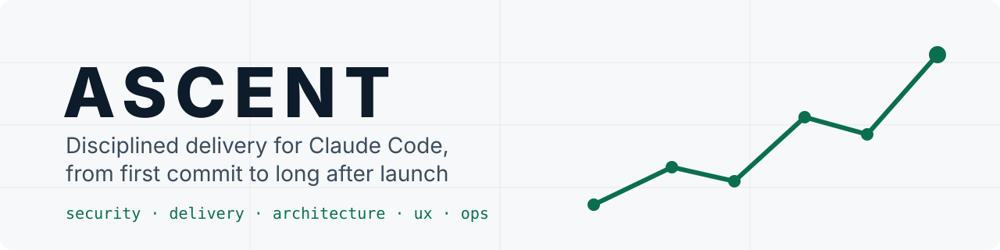
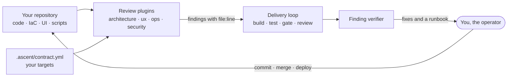

<h1>
<picture>
  <source media="(prefers-color-scheme: dark)" srcset="docs/assets/ascent-banner-dark.svg">
  
</picture>
</h1>

<p align="center">
  <a href="https://github.com/lloydbrian/lloydbriantech-ascent/actions/workflows/validate-skills.yml"></a>
  <a href="https://github.com/lloydbrian/lloydbriantech-ascent/releases"></a>
  <a href="#plugins-for-any-repository"></a>
  <a href="LICENSE"></a>
</p>

<p align="center">
  <a href="#plugins-for-any-repository">Plugins</a> ·
  <a href="#quick-start">Quick start</a> ·
  <a href="#how-it-works">How it works</a> ·
  <a href="#scaffold-a-new-project">Scaffold</a> ·
  <a href="#status-and-roadmap">Roadmap</a> ·
  <a href="#documentation">Docs</a>
</p>

ASCENT is an opinionated engineering framework for [Claude Code](https://claude.com/claude-code). It turns the habits that keep software healthy for years into checks Claude can run: architecture against measurable targets, accessibility with WCAG evidence, operations that someone else can run, security baselines, and a delivery loop where Claude builds and verifies while you own every commit and deploy.

You can use it in two ways:

| Aspect | **Plugins** | **Parent skill** |
|---|---|---|
| For | Any repository, ASCENT or not | Starting, enhancing or migrating a project |
| You get | Four read-only review plugins and the delivery loop | A scaffolded project with 28 embedded `ascent-*` skills |
| Install | Two commands in Claude Code | `make install` from this repository |

## Why ASCENT

Most frameworks optimize for Day 0, the scaffold. ASCENT optimizes for **Day 0 through Day 1000**: the long stretch where decisions turn into lore, documentation drifts from the code, and quality slips. Most of that slippage is not a skill problem. It is a consistency problem under fatigue, handoff and time pressure.

ASCENT writes those patterns down as checks with evidence: a project contract with measurable targets, severity tables that leave no room for invented ratings, operator runbooks with pre-flight and post-flight checks, and ADRs for every decision someone might later question. The framework is built with its own rules: 13 ADRs, phase-gated delivery, and a plugin gate with hundreds of negative controls. [PHILOSOPHY.md](docs/framework/PHILOSOPHY.md) has the full rationale.

## Plugins for any repository

| Plugin | Version | Pillars | Ask Claude | What it does |
|---|---|---|---|---|
| [`ascent-security`](plugins/ascent-security/README.md) | 0.1.1 | Trust and security, compliance | "any secrets committed?" | `.env` discipline, hardcoded credentials, container privilege, nginx headers, production URLs and dynamic code execution, plus a `security-auditor` agent |
| [`ascent-delivery`](plugins/ascent-delivery/README.md) | 0.1.0 | Business value, trust and security, resilience | "ship this change" | The delivery loop: decide, build with a file audit, test with negative controls, gate, independent review checked by a `finding-verifier`, and an operator runbook. A hook blocks Claude from git writes and deploys |
| [`ascent-architecture`](plugins/ascent-architecture/README.md) | 0.1.1 | Business value, resilience | "is this production-ready?" | Quality attributes against measurable targets, design principles, deployment options with dated cost estimates, and a CloudFormation static-site blueprint |
| [`ascent-ux`](plugins/ascent-ux/README.md) | 0.1.0 | Compliance, business value | "is this UI accessible?" | WCAG 2.2 AA evidence from static checks and a Playwright browser pass, exact design-token contrast, and five accessible design directions shown as mocks |
| [`ascent-ops`](plugins/ascent-ops/README.md) | 0.1.0 | Resilience, compliance, trust and security | "is this operable?" | Secure-by-design IaC configuration, zero-touch scripts and runbooks, and Maintenance and Troubleshooting manuals proven current, plus an operable-service blueprint |

Every review plugin has a read-only reviewer agent for delivery-loop reviews and second opinions.

The pillars are the four outcomes the checks serve: driving business value, compliance, trust and security, and resilience. [PILLARS.md](docs/framework/PILLARS.md) maps each quality attribute to the plugin or skill that checks it, the evidence it produces and the gaps that remain.

### What every plugin promises

- **Read-only by default.** Reviews never edit your files. Skills that write, such as `ops-manuals` or `design-directions`, write only the files they name and never commit.
- **Evidence or it is not a finding.** Every finding cites `path/to/file:line`, or the paths searched when something is absent, plus a failure scenario and a fix.
- **Ratings from a table.** Each review plugin rates findings only from its severity table. For architecture, ux and ops the gate checks that the skill's and the agent's copies match; the two `ascent-security` skills share one table.
- **Your targets, not an ideal.** The project contract, `.ascent/contract.yml`, holds measurable targets for the architecture, ux and ops plugins (`ascent-delivery` reads `.delivery-loop.yml`). With no contract, those plugins propose one from what the repository declares and rates against enterprise defaults until you confirm it.
- **You own every write.** Claude never commits, pushes, tags, merges or deploys. It writes a numbered runbook and you run it; `ascent-delivery`'s hook enforces this.
- **No personal data.** Secret values, account ids and contact details never appear in a report.

### The bar a plugin must clear before release

1. Hardened source, with severity tables pinned by the plugin gate (`make test-plugins`).
2. Behavior tests for every script and rule (Principle §16), run on macOS and Linux; scripts also run under the stock macOS `/bin/bash` 3.2.
3. Negative controls (`make test-mutants`): every rule is broken on purpose, and a named test must fail.
4. A version bump for any change, enforced by `make/plugins.lock`, so installed copies always update.
5. A read-only trial on real repositories, with calibration rounds until the findings hold up.
6. A release record: CHANGELOG entry, ADR and tag.

## Quick start

In Claude Code (CLI, VS Code extension or desktop app):

```
/plugin marketplace add lloydbrian/lloydbriantech-ascent
/plugin install ascent-architecture@lloydbriantech-ascent
```

Install any of the five the same way. Then ask in plain language, for example "review the architecture" or "is this operable?". Start with the reviews; add `ascent-delivery` when you want Claude to take changes from decision to a runbook you run.

> [!NOTE]
> While `ascent-delivery` is enabled, its hook blocks Claude from committing, pushing, tagging, merging and deploying in every session. That is the point: you run those steps from the runbook Claude writes.

## How it works



In words: the review plugins read your repository against the targets in your contract and report findings with `file:line`. The delivery loop fixes what the finding verifier confirms and writes a runbook. You run the commits, merges and deploys.

The plugins follow four patterns proven in the embedded skills ([patterns.md](skills/lloydbriantech-ascent/references/patterns.md)):

| Pattern | What it means | Example |
|---|---|---|
| Sibling | Skills that check overlapping areas read the same sources and never invoke each other | `env-audit` and `security-audit` |
| Hybrid aggregator | An entry-point review runs light surface checks and recommends a deeper skill only where one flags a concern | `ops-review` → `iac-config-check` |
| Detect, don't ask | A skill proposes its configuration from what the repository declares, then asks once to confirm | the contract proposal in the architecture, ux and ops reviews |
| Enumerate / summarize | One skill lists findings; a sibling rates the overall stance | `security-audit` and `sec-posture` |

A fifth, **conductor**, is a candidate: the delivery loop orchestrates reviewers and the verifier without doing their work.

## Scaffold a new project

The parent skill, `lloydbriantech-ascent`, starts new projects, enhances ASCENT projects and migrates others. It routes each request to one of nine engineering roles (delivery lead, architect, UI/UX designer, developer, data engineer, AI engineer, tester, devops, cybersecurity) and one of three modes (scaffold, enhance, migrate).

```bash
gh repo clone lloydbrian/lloydbriantech-ascent ~/Developer/repositories/lloydbriantech-ascent
cd ~/Developer/repositories/lloydbriantech-ascent
make install        # symlinks the skill into ~/.claude/skills/
```

Then, in an empty directory in Claude Code: *"Use lloydbriantech-ascent to scaffold this as my-new-project."* Claude asks a short set of questions and builds the project from the template, with slugs derived from the one name you give it.

```
my-new-project/
├── .ascent-meta.json              # project identity and phase
├── .claude/skills/ascent-*/       # 28 project-embedded skills
├── backend/                       # Express + SQLite (WAL), containerized
├── frontend/                      # React + Vite, containerized
├── docker-compose*.yml            # dev, prod and distribution stacks
├── nginx/                         # reverse proxy with security headers
├── Makefile + make/*.mk           # SDLC-sectioned operator vocabulary
├── docs/architecture/decisions/   # starter ADRs and an index
└── docs/delivery/                 # session state and working memory
```

`make dev-up` starts the stack; the API answers on `/-/health` and `/-/ready`.

> [!IMPORTANT]
> Scaffolding today is guided: Claude writes the project from the template. Scripted scaffolding (`scaffold.py` and friends, Phase 4) and a GitHub template repository (Phase 6) are on the [roadmap](docs/framework/ROADMAP.md) and not available yet.

<details>
<summary><strong>The 16 principles every ASCENT project holds</strong></summary>

| # | Principle | What it enforces |
|---|---|---|
| §1 | Containerization-first | The dev environment is the container; `make dev-up` from a bare host |
| §2 | Make as operator vocabulary | One `make` target per operation, the same name in dev, CI and runbooks |
| §3 | SDLC-sectioned help | `make help` groups targets by lifecycle stage |
| §4 | Stub-first naming | Future targets ship under their final name from Day 1 |
| §5 | `.env` discipline | `.env` never committed; `.env.example` with empty defaults only |
| §6 | Strict backend layering | routes → controllers → services → storage; only storage writes |
| §7 | ADR discipline | Every constraining decision gets an ADR |
| §8 | Phase-gated delivery | Numbered phases, exit criteria, an explicit go-signal |
| §9 | Label-based scoping | Every container, volume and network carries the project label |
| §10 | Engine compatibility | Podman or Docker, detected; no hard-coded runtime |
| §11 | Context-aware execution | Skills adapt to the current phase and project state |
| §12 | Graceful shutdown | SIGTERM with a configurable grace period |
| §13 | Dev-status family | `make dev-status` reports containers, database and endpoints |
| §14 | Persona-segmented docs | Every doc names its reader; three clicks to anything |
| §15 | Session resumption | Working state and decisions survive across sessions |
| §16 | Behavior verification | Tests prove behavior, not that documentation mentions it |

Full text and rationale: [PRINCIPLES.md](docs/framework/PRINCIPLES.md).

</details>

<details>
<summary><strong>The 28 project-embedded skills</strong></summary>

**Baseline (always scaffolded):** `ascent-self-audit` · `ascent-layering-check` · `ascent-env-audit` · `ascent-observability-check` · `ascent-delivery-status` · `ascent-feature-intake` · `ascent-standup` · `ascent-adr-write` · `ascent-doc-stub` · `ascent-make-target` · `ascent-reflect` · `ascent-handoff` · `ascent-onboard` · `ascent-health`

**Specialized and conditional:** `ascent-data-health` · `ascent-doc-sweep` · `ascent-dependency-health` · `ascent-adr-conformance` · `ascent-skills-doctor` · `ascent-qa` · `ascent-release-readiness` · `ascent-security-audit` · `ascent-sec-posture` · `ascent-cost-posture` · `ascent-vitality` · `ascent-ai-evals` · `ascent-design-system-audit` · `ascent-persona-coverage`

Each has a behavior test that runs on macOS and Linux (`make test-skills`); negative controls in `make/mutants.tsv` prove 13 of those tests can fail, and the rest are on the list. The security skills also ship as the `ascent-security` plugin, generated from the same source ([ADR-009](docs/framework/DECISIONS/ADR-009-plugins-generated-from-template-skills.md)).

</details>

## Status and roadmap

ASCENT is pre-1.0 and changes quickly; every change is recorded in the [CHANGELOG](CHANGELOG.md).

| Release | Date | Highlights |
|---|---|---|
| v0.4.6 | 2026-10-26 | `ascent-ops` 0.1.0, `ascent-architecture` 0.1.1, health endpoints renamed to `/-/health` and `/-/ready`, the pillar map |
| v0.4.5 | 2026-10-25 | `ascent-ux` 0.1.0: WCAG 2.2 evidence, token contrast, design directions |
| v0.4.4 | 2026-10-24 | `ascent-architecture` 0.1.0 and the shared project contract |
| v0.4.3 | 2026-10-18 | `ascent-delivery` 0.1.0, security rules, the plugin version gate |
| v0.4.2 | 2026-10-18 | Portable skill tests with negative controls; `ascent-security`, the first plugin |
| v0.4.1 | 2026-05-21 | Phase 3 retrospective: four patterns, Principle §16 |
| v0.4.0 | 2026-05-20 | Phase 3: 28 project-embedded skills |
| v0.3.1 | 2026-05-17 | Session resumption (§15) |
| v0.3.0 | 2026-05-16 | Phase 2: the full project template |
| v0.2.0 | 2026-05-15 | Phase 1: the parent skill and reference modules |
| v0.1.0-alpha | 2026-05-14 | Phase 0: foundation and the first ADRs |

**Plugin roadmap:** architecture ✅ · ux ✅ · ops ✅ · quality · session · adr · docs · node-stack.
**Phases:** Phase 4, scripted scaffolding, waits for its go-signal; then the eval harness (5), the template repository (6) and a first production project (7, v1.0). Details and exit criteria: [ROADMAP.md](docs/framework/ROADMAP.md).

## Documentation

| If you want to… | Read |
|---|---|
| Understand why ASCENT exists | [PHILOSOPHY.md](docs/framework/PHILOSOPHY.md) |
| See the invariants every project holds | [PRINCIPLES.md](docs/framework/PRINCIPLES.md) |
| Check whether ASCENT fits your project | [SCOPE.md](docs/framework/SCOPE.md) |
| See which quality attributes each plugin checks, by pillar | [PILLARS.md](docs/framework/PILLARS.md) |
| Learn how the framework and plugins are built | [ARCHITECTURE.md](docs/framework/ARCHITECTURE.md) |
| Read the decisions and their trade-offs | [DECISIONS/INDEX.md](docs/framework/DECISIONS/INDEX.md) |
| See what is next | [ROADMAP.md](docs/framework/ROADMAP.md) |
| Contribute a fix, a skill or a plugin | [CONTRIBUTING.md](CONTRIBUTING.md) |
| See what changed | [CHANGELOG.md](CHANGELOG.md) |

Documentation is organized by reader; the persona map is in [audience-mapping.md](skills/lloydbriantech-ascent/references/audience-mapping.md).

## Contributing

Issues and proposals are welcome: [report a bug](https://github.com/lloydbrian/lloydbriantech-ascent/issues/new?template=skill-bug.md) in a plugin or skill, [propose a plugin](https://github.com/lloydbrian/lloydbriantech-ascent/issues/new?template=plugin-proposal.md) or [propose a skill](https://github.com/lloydbrian/lloydbriantech-ascent/issues/new?template=new-skill-proposal.md). [CONTRIBUTING.md](CONTRIBUTING.md) explains the contribution bar, including what a plugin needs before it ships. ASCENT is maintained by `lloydbriantech`.

## Support

ASCENT is free and open source. If it saves you time, support is appreciated and never expected: ☕ [buymeacoffee.com/lloydbriantech](https://buymeacoffee.com/lloydbriantech)

## License

Dual-licensed under [MIT](LICENSE-MIT) or [Apache 2.0](LICENSE-APACHE), at your option ([ADR-006](docs/framework/DECISIONS/ADR-006-dual-licensing.md)). Unless you state otherwise, any contribution you submit is dual-licensed the same way, with no additional terms.
