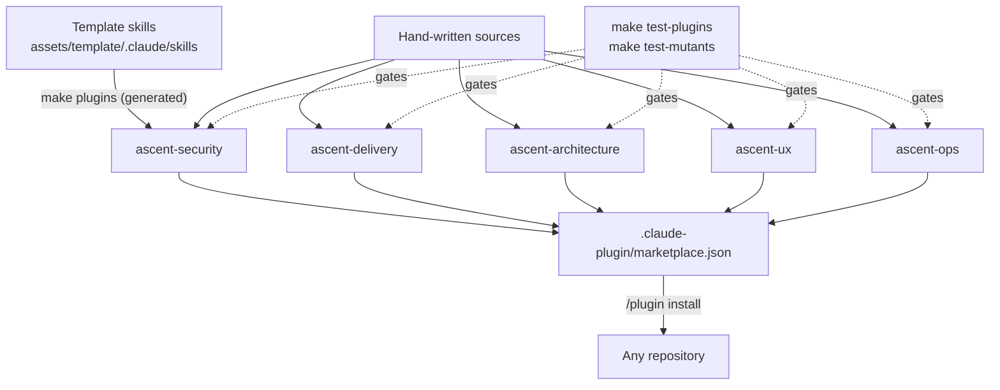

# ASCENT Framework Architecture

How the framework is built. This document describes the four-layer architecture of the framework itself, and the plugin channel that ships its checks to any repository. It does not cover the architecture of projects scaffolded by it. For project-level architecture, see the architect role's reference modules.

---

## The four layers

ASCENT is a four-layer system. Each layer has a single responsibility and a clean boundary.

```
┌─────────────────────────────────────────────────────────────────┐
│                                                                  │
│  LAYER 4 — Scaffolded Projects (one per project, user-owned)    │
│  ──────────────────────────────────────────────────────────     │
│   .ascent-meta.json    .claude/skills/ascent-*    docs/  ...     │
│                                                                  │
│   The output of running the framework on a project.              │
│   Lives in the user's repos, not in this repo.                   │
│                                                                  │
└─────────────────────────────────────────────────────────────────┘
                              ▲
                              │ scaffold / enhance / migrate
                              │
┌─────────────────────────────────────────────────────────────────┐
│                                                                  │
│  LAYER 3 — Template Repo (lloydbriantech-ascent-starter)        │
│  ──────────────────────────────────────────────────────────     │
│   A ready-made scaffold, published as a GitHub template.         │
│   Users gh repo create --template for instant working stack.     │
│   Generated from Layer 2 by CI on every framework tag.           │
│   Force-pushed; never edited directly.                           │
│                                                                  │
└─────────────────────────────────────────────────────────────────┘
                              ▲
                              │ tools/build-starter.sh
                              │
┌─────────────────────────────────────────────────────────────────┐
│                                                                  │
│  LAYER 2 — Parent Skill (lloydbriantech-ascent)                 │
│  ──────────────────────────────────────────────────────────     │
│   SKILL.md   references/   assets/template/   scripts/           │
│                                                                  │
│   The active source of truth. Routes user intent to roles,       │
│   loads reference modules, performs scaffold/enhance/migrate.    │
│                                                                  │
└─────────────────────────────────────────────────────────────────┘
                              ▲
                              │ built and maintained in
                              │
┌─────────────────────────────────────────────────────────────────┐
│                                                                  │
│  LAYER 1 — Meta-Repository (lloydbrian/lloydbriantech-ascent)   │
│  ──────────────────────────────────────────────────────────     │
│   README.md, CLAUDE.md, CHANGELOG, docs/, skills/, tools/, tests/│
│                                                                  │
│   The repo you're reading. Contains the framework's source,      │
│   documentation, ADRs, tooling, and tests.                       │
│                                                                  │
└─────────────────────────────────────────────────────────────────┘
```

### Layer 1 — Meta-Repository

This repository (`lloydbrian/lloydbriantech-ascent`). The source of truth for everything.

Contains:

- Framework documentation (`docs/framework/`)
- Framework ADRs (`docs/framework/DECISIONS/`)
- The parent skill source (`skills/lloydbriantech-ascent/`)
- The Claude Code plugins and their marketplace (`plugins/`, `.claude-plugin/marketplace.json`); see [The plugin channel](#the-plugin-channel)
- The gates and negative controls (`make/`), plugin behavior tests (`tests/plugins/`), and the Phase 2 smoke-test scaffold (`tools/scratch/`)
- Eval scenarios arrive with Phase 5
- Repository hygiene (CI workflows, issue templates, editor config)

The meta-repository **applies ASCENT to itself**: Makefile-as-operator-vocabulary, ADR discipline, persona-segmented docs, dual licensing, phase-gated delivery.

### Layer 2 — Parent Skill

The `lloydbriantech-ascent` skill, which lives at `skills/lloydbriantech-ascent/` inside Layer 1. When installed, it's symlinked into `~/.claude/skills/`.

The skill is one Claude skill, not nine. It routes by user intent to one of nine role modules at runtime. This is the consequence of [ADR-001](DECISIONS/ADR-001-single-parent-skill.md): nine separate skills would produce trigger collisions when the user describes a task that could plausibly land in multiple roles.

Internal structure:

```
skills/lloydbriantech-ascent/
├── SKILL.md                       # Frontmatter + role-routing logic
├── references/                    # Loaded into context as needed
│   ├── role-delivery-lead.md
│   ├── role-architect.md
│   ├── role-ui-ux-designer.md
│   ├── role-developer.md
│   ├── role-data-engineer.md
│   ├── role-ai-engineer.md
│   ├── role-tester.md
│   ├── role-devops.md
│   ├── role-cybersecurity.md
│   ├── ASCENT-INVARIANTS.md       # The 16 principles
│   ├── MAKE-NAMING.md             # The naming convention
│   ├── SLUG-CONVENTIONS.md        # Slug taxonomy
│   ├── PHASE-PROTOCOL.md          # Phase-gated delivery
│   ├── ENV-DISCIPLINE.md          # .env handling
│   ├── ADR-TEMPLATE.md            # The canonical ADR format
│   ├── feature-lifecycle.md       # How features traverse roles
│   ├── observability-contract.md  # What every service emits
│   ├── patterns.md                # Sibling, hybrid, detect-don't-ask, enumerate/summarize
│   ├── session-protocol.md        # Session resumption (§15)
│   ├── writing-style.md           # Doc voice/tense/anti-patterns
│   ├── doc-architecture.md        # Persona navigation
│   ├── audience-mapping.md        # Persona → doc mapping
│   └── external-services-integration.md  # Vendor patterns
└── assets/template/               # Files copied + slug-substituted into projects
    ├── .claude/skills/ascent-*/   # The 28 project-embedded skills
    └── (the substantive baseline content)
```

The scaffolding scripts (`scripts/scaffold.py`, `bootstrap.py`, `enhance.py`, `migrate.py`) arrive in Phase 4. Until then, Claude performs each mode by following the skill and copying from `assets/template/`.

### Layer 3 — Template Repo

**Status:** planned for Phase 6. The starter repository does not exist yet; this section describes the design.

The `lloydbrian/lloydbriantech-ascent-starter` repository is a separate GitHub repo marked as a GitHub Template. Users `gh repo create --template` from it to get a 5-second working scaffold.

This layer is **generated**, not authored. The CI workflow `release.yml` runs `tools/build-starter.sh` on every framework tag, which:

1. Takes the parent skill's `assets/template/` directory
2. Resolves all slug placeholders to the default `ascent-starter` slug
3. Force-pushes the result to the starter repo with a matching tag

The starter repo is never edited directly. Direct edits would be lost on the next release. The pattern is identical to how generated artifacts are handled in any mature build system: you don't edit `dist/`, you edit `src/`.

### Layer 4 — Scaffolded Projects

User-owned repositories that ASCENT has scaffolded. Each one contains:

- `.ascent-meta.json` at the project root marking it as an ASCENT project
- `.claude/skills/ascent-*/` directories, the project-embedded skills
- The full project tree per the architect role's defaults
- Any project-level ADRs the user has added

These projects are independent. They don't pull from the framework at runtime. The framework's role ends after scaffolding. From that point forward, the project is the user's, and they can run `lloydbriantech-ascent enhance` to add to it, run `migrate` to upgrade it, or stop using the framework entirely.

---

## The plugin channel

The four layers deliver ASCENT to projects it scaffolds. Plugins deliver its checks to **any** repository, with no scaffold and no `.ascent-meta.json`. Since v0.4.2 they are the framework's main delivery channel.



| Plugin | Source | Decision |
|---|---|---|
| `ascent-security` | Hybrid: three skills generated from the template's security skills, so there is one source of truth; the hand-written `dependency-check` and its scripts | [ADR-009](DECISIONS/ADR-009-plugins-generated-from-template-skills.md), [ADR-016](DECISIONS/ADR-016-dependency-checks-in-ascent-security.md) |
| `ascent-delivery` | Hand-written; the delivery loop, the finding verifier and the operator-boundary hook | [ADR-010](DECISIONS/ADR-010-delivery-loop-plugin-and-operator-boundary-hook.md) |
| `ascent-architecture` | Hand-written; introduces the shared project contract | [ADR-011](DECISIONS/ADR-011-architecture-plugin-and-project-contract.md) |
| `ascent-ux` | Hand-written; the first plugin with dependencies (`design`, `frontend-design`, `playwright`) | [ADR-012](DECISIONS/ADR-012-ux-plugin-design-directions-and-plugin-dependencies.md) |
| `ascent-ops` | Hand-written; operations manuals and the `/-/health` endpoint names | [ADR-013](DECISIONS/ADR-013-ops-plugin-manuals-and-endpoint-names.md) |

### What the plugins share

- **The project contract.** `.ascent/contract.yml` (or `.claude/contract.yml` where ASCENT-named files are not allowed) holds one section per plugin (`architecture:`, `ux:`, `ops:`, `security:`) with measurable targets and a maturity target: enterprise, standard or prototype. A review with no contract proposes one from what the repository declares (detect, don't ask) and rates against enterprise defaults until the operator confirms it.
- **Severity tables.** Each review plugin rates findings only from its table. In architecture, ux and ops the table is marked in the source so the gate can check that the skill's and the agent's copies are identical; the two `ascent-security` skills share one checked table, and its agent carries a summary; its `dependency-check` table is marked and copied into the agent. A concern that matches no row is listed as unrated.
- **Read-only reviewer agents** (Read, Grep, Glob only) that the delivery loop uses as review lenses.
- **The operator boundary.** Claude never runs git writes, `gh` writes, merges, tags, releases or deploys. While `ascent-delivery` is enabled, its `PreToolUse` hook blocks them; Claude writes a runbook instead.
- **The four patterns** from Phase 3 ([patterns.md](../../skills/lloydbriantech-ascent/references/patterns.md)): sibling skills, a hybrid aggregator entry point, detect-don't-ask, and enumerate/summarize. The delivery loop's orchestration of reviewers is a candidate fifth pattern, the conductor.
- **Four pillars.** Every check serves driving business value, compliance, trust and security, or resilience. [PILLARS.md](PILLARS.md) maps the quality attributes to the plugins that check them, and lists the gaps.

### The plugin gate

`make test-plugins` runs T1–T13 on every plugin: generated skills match a fresh build (T1), no placeholders (T2), names and versions agree with the marketplace (T3), agents and skills pre-approve only read tools (T4, T4b), severity tables match (T5), links resolve (T6), frontmatter (T7), `claude plugin validate` (T8), agents cite steps that exist (T9), a version bump for every content change via `make/plugins.lock` (T10), behavior tests pass for every plugin with scripts or hooks (T11), manifests use only known keys (T12), and the ownership registry, [OWNERSHIP.md](OWNERSHIP.md), matches the repository (T13): one owner for every plugin, component, rule-id family, contract section, domain and review lens, and plugin-qualified rule ids ([ADR-015](DECISIONS/ADR-015-ownership-registry-and-gate.md)).

`make test-mutants` holds the negative controls: each one breaks a rule in a copy of the repository and requires a named gate check to fail. Controls run in groups, one CI job per group and platform, listed by `make test-mutants-groups`.

### Release path

Every plugin goes through the delivery loop: hardened source, behavior tests, negative controls, the gate, an independent review checked by the finding verifier, a read-only trial on real repositories with calibration rounds, and a release record (CHANGELOG, ADR, tag). The marketplace lives in this repository until a dedicated `lloydbriantech-claude-marketplace` exists (ADR-009).

---

## Cross-cutting concerns

### Versioning

Lockstep across layers:

- Layer 1: git tag on the meta-repo (`v0.3.0`)
- Layer 2: `version:` field in `SKILL.md` frontmatter (`0.3.0`)
- Layer 3: git tag on the starter repo (`v0.3.0`), force-pushed by CI (from Phase 6)
- Layer 4: `framework_version` field in `.ascent-meta.json`

Plugins version independently: each has its own semver in `plugin.json` and the marketplace entry, and `make/plugins.lock` records the content hash per version (T10).

### Mode detection

The skill (Layer 2) detects which mode to operate in by reading the target directory:

| Condition | Mode | Behavior |
|---|---|---|
| No `.ascent-meta.json` present | `scaffold` | Greenfield creation; interview + full project tree |
| `.ascent-meta.json` present | `enhance` | Read existing state; additive changes only |
| User invokes with `--migrate` | `migrate` | Bring non-ASCENT project to ASCENT standards |
| Directory contains `ascent-starter` slug and `.ascent-meta.json` is a placeholder | `bootstrap` | User cloned the starter; perform interview + slug replacement |

### Slug derivation

User provides one slug; framework derives the rest:

```
INPUT:  lawn-care-app

DERIVED:
  PROJECT_SLUG_UPPER       LAWN_CARE_APP
  PROJECT_TITLE            Lawn Care App
  PROJECT_PKG              lawn-care-app
  PROJECT_LABEL            lawn-care-app
  CONTAINER_DEV            lawn-care-app-dev
  CONTAINER_PROD           lawn-care-app-prod
  IMAGE_DEV                lawn-care-app:dev
  IMAGE_PROD               lawn-care-app:prod
  INSIDE_CONTAINER_MARKER  LAWN_CARE_APP_INSIDE_CONTAINER
```

See [ADR-004](DECISIONS/ADR-004-slug-conventions.md) for the derivation rules.

### Modify-not-overwrite

When the skill (Layer 2) writes to a scaffolded project (Layer 4) in `enhance` or `migrate` mode, it never overwrites whole files. It performs surgical edits using `str_replace`-style operations. This is the contract that allows multi-mode operation to coexist with user customization.

See [ADR-002](DECISIONS/ADR-002-modify-not-overwrite.md) for the rationale.

### Dogfooding

Layer 1 (this repo) applies ASCENT to itself wherever applicable. The Makefile uses the SDLC-sectioned help convention. The CHANGELOG follows Keep a Changelog. The licensing is dual MIT/Apache-2.0. The ADRs use the canonical template. The CI workflows mirror what the framework would generate in a scaffolded project.

The exceptions are deliberate: Layer 1 doesn't have a backend or a frontend, so the architect role's full output doesn't apply. The dogfooded portion is what's relevant to a meta-repo: discipline, conventions, decisions.

---

## What the framework is not

### Not a runtime

Scaffolded projects do not import a framework library. The framework's "output" is *files*, and those files are independent of the framework after creation. This is intentional. A framework with a runtime would couple every scaffolded project to the framework's release cadence; ASCENT scaffolds projects that survive the framework's deletion.

### Not a build system

The Makefile structure ASCENT generates is operator vocabulary, not a build system. It delegates to language-native build tools (npm, vite, etc.) where needed. The framework doesn't compete with `webpack`, `gradle`, `cargo`, or `make` itself.

### Not a deploy system

The infra targets in `make/infra.mk` are convenient wrappers around AWS CLI calls. They are not a deploy abstraction layer. ASCENT doesn't invent its own deploy model; it provides consistent operator vocabulary for the deploy model AWS already offers.

### Not a service mesh

ASCENT is for projects with one or a small handful of services. Service-to-service communication at larger scale needs different tooling (Linkerd, Istio, Consul). The framework's networking patterns are simple by design.

---

## Reading further

| Topic | Where |
|---|---|
| Why one parent skill instead of six | [ADR-001](DECISIONS/ADR-001-single-parent-skill.md) |
| Why modify-not-overwrite | [ADR-002](DECISIONS/ADR-002-modify-not-overwrite.md) |
| Why `.ascent-meta.json` at project root | [ADR-003](DECISIONS/ADR-003-ascent-meta-marker.md) |
| How slugs are derived | [ADR-004](DECISIONS/ADR-004-slug-conventions.md) |
| Why the naming conventions are what they are | [ADR-005](DECISIONS/ADR-005-skill-naming.md) |
| Why dual MIT/Apache-2.0 licensing | [ADR-006](DECISIONS/ADR-006-dual-licensing.md) |
| Why pair the skill with a template repo | [ADR-007](DECISIONS/ADR-007-template-repo-pairing.md) |
| How skill tests prove they can fail | [ADR-008](DECISIONS/ADR-008-portable-skill-tests-and-negative-controls.md) |
| Why plugins are generated from the template skills | [ADR-009](DECISIONS/ADR-009-plugins-generated-from-template-skills.md) |
| Why Claude never commits or deploys | [ADR-010](DECISIONS/ADR-010-delivery-loop-plugin-and-operator-boundary-hook.md) |
| The project contract | [ADR-011](DECISIONS/ADR-011-architecture-plugin-and-project-contract.md) |
| Plugin dependencies and design directions | [ADR-012](DECISIONS/ADR-012-ux-plugin-design-directions-and-plugin-dependencies.md) |
| Operations manuals and endpoint names | [ADR-013](DECISIONS/ADR-013-ops-plugin-manuals-and-endpoint-names.md) |
| What's planned for future phases | [`ROADMAP.md`](ROADMAP.md) |
