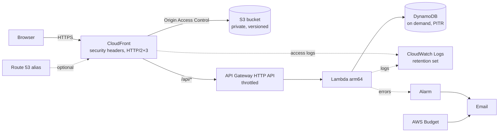

# Blueprint: static-site-serverless-aws

A public website served from a private S3 bucket through CloudFront, with an optional serverless API under `/api/*`. It is the first ASCENT deployment blueprint (decision 8, 2026-10-18), and the pattern the tennis site already runs. Version 0.1.0.

| File | What it is |
|---|---|
| [template.yaml](template.yaml) | CloudFormation template: one stack, us-east-1 |
| [usage-small.tsv](usage-small.tsv) | Usage profile for a small site, used for the cost estimate |

## When to choose it

- **Good fit:** content sites, documentation, club, team and event sites, and light APIs (forms, scores, small CRUD). Traffic can be spiky or close to zero. Single-page apps fit too, with one addition (see Adapting it).
- **Poor fit:** long-running jobs over 15 minutes, WebSockets with heavy fan-out, server-side rendering on every request, relational data with complex joins, or anything that needs a fixed IP. See the other options in [deployment-options](../../skills/deployment-options/SKILL.md).

## Architecture



| Component | Why | Quality attributes it serves |
|---|---|---|
| S3, private, versioned, retained | Durable origin; versions allow rollback of content; `Retain` keeps data if the stack is deleted | Reliability, recoverability |
| CloudFront with Origin Access Control | Only CloudFront can read the bucket; HTTPS only; caching at the edge | Security, performance, cost |
| Response headers policy | HSTS, CSP, `nosniff`, frame and referrer policy on every response | Security |
| HTTP API, throttled | Cheapest API Gateway type; burst 50, rate 25 caps runaway cost and abuse | Cost, availability |
| Lambda arm64, least-privilege role | No servers to patch; pays per request; the role reaches only its table and log group | Operability, security, cost |
| DynamoDB on demand with point-in-time recovery | No capacity planning; restore to any second in the last 35 days | Scalability, recoverability |
| Log groups with retention, CDN access logs | Evidence for incidents without unbounded log cost | Observability, cost |
| Error alarm, monthly budget, SNS email | You hear about errors and spend before users or the bill tell you | Operability, cost |

Missing files return a real 404: the bucket policy lets CloudFront list the bucket, so S3 answers 404 instead of 403. There is no custom error page by default, because CloudFront error pages apply to the whole distribution, including `/api/*` responses.

Deploy in **us-east-1**, because CloudFront certificates and CloudFront log delivery must live there. The API runs in the same region. If users are far from the US, the CDN still serves static content from the nearest edge.

## Mechanical checks

`scripts/check-cfn-static-site.sh` runs 12 checks on any CloudFormation YAML template that follows this pattern. This template passes all 12, and the plugin's tests prove that each check fails when its property is removed.

```bash
# PLUGIN_ROOT: plugins/ascent-architecture in a clone of lloydbriantech-ascent,
# or the installed copy under ~/.claude/plugins/cache/
bash "$PLUGIN_ROOT/scripts/check-cfn-static-site.sh" infra/template.yaml
```

## Cost

Estimated with `scripts/estimate-cost.sh` and the plugin's pricing file (AWS us-east-1 list prices, **as_of 2026-10-18**), for [usage-small.tsv](usage-small.tsv): about 5,000 visitors and 150,000 API calls a month.

| Pricing | Monthly estimate |
|---|---|
| Pay-as-you-go, always-free allowances applied | **0.86 USD** |
| Pay-as-you-go, no free allowances (the account already uses them elsewhere) | **5.88 USD** |
| CloudFront flat-rate plan for this template as written: Business, because it delivers access logs and uses its own security headers policy | 200.23 USD (not cheaper) |
| Flat-rate Free plan, only if you drop the access logs and switch to the AWS managed security headers policy (no CSP) | 0.23 USD |

Flat-rate plans bundle the CDN, WAF and DDoS protection, DNS for the apex domain and S3 credits with no overage charges, but each tier unlocks features: access logs need Pro or higher, and custom response header policies need Business or higher. Accounts on the AWS Free Tier plan cannot subscribe. For this blueprint, pay-as-you-go is the cheaper choice unless you need WAF; then compare the Pro or Business plan with WAF on pay-as-you-go (about 5 USD a month plus rules).

These are estimates, not quotes. They exclude tax, support plans and domain registration. The biggest drivers as traffic grows are CloudFront data out, API requests and Lambda duration. Re-run the estimate with measured numbers after the first month:

```bash
# PLUGIN_ROOT: plugins/ascent-architecture in a clone of lloydbriantech-ascent,
# or the installed copy under ~/.claude/plugins/cache/
bash "$PLUGIN_ROOT/scripts/estimate-cost.sh" \
  "$PLUGIN_ROOT/pricing/aws-us-east-1.tsv" docs/architecture/usage.tsv \
  --plans "$PLUGIN_ROOT/pricing/aws-cloudfront-flat-rate.tsv"
```

## Setup effort

About half a day for someone new to AWS, an hour or two otherwise. That covers the account, a certificate, the first deploy and DNS. There are no servers, so routine operation is limited to:

- **Monthly:** read the budget email, and check the alarm history.
- **Yearly:** move the Lambda runtime before its end of support (the template uses Node.js 24, supported until April 2028), and refresh the pricing file and estimate.
- **Per release:** upload the site, invalidate the cache and check the build stamp (the operator runbook below).

## Deploy (the operator runs this; Claude never deploys)

Values that identify you or your account are declared into shell variables at run time. They are never written into files, commits or chat.

```bash
read -r  -p "AWS profile: " AWS_PROFILE; export AWS_PROFILE      # credentials stay in your AWS config
read -r  -p "Project slug: " PROJECT
read -r  -p "Alert email: " ALERT_EMAIL                          # personal data: variable only
REGION=us-east-1

# 1. Dry run: create a change set and review it. Nothing changes yet.
aws cloudformation deploy --region "$REGION" --stack-name "$PROJECT" \
  --template-file template.yaml --capabilities CAPABILITY_IAM --no-execute-changeset \
  --parameter-overrides ProjectName="$PROJECT" AlertEmail="$ALERT_EMAIL"
# Run the describe-change-set command it prints. Check the stack name, region, and
# that no Retain resource (SiteBucket, DataTable) shows "Replacement: True".

# 2. Apply it.
read -r -p "Change set ARN: " CHANGESET
aws cloudformation execute-change-set --region "$REGION" --change-set-name "$CHANGESET"
aws cloudformation wait stack-create-complete --region "$REGION" --stack-name "$PROJECT"   # stack-update-complete on updates

# 3. Upload the site: dry run, then real.
BUCKET=$(aws cloudformation describe-stacks --region "$REGION" --stack-name "$PROJECT" \
  --query "Stacks[0].Outputs[?OutputKey=='SiteBucketName'].OutputValue" --output text)
DIST=$(aws cloudformation describe-stacks --region "$REGION" --stack-name "$PROJECT" \
  --query "Stacks[0].Outputs[?OutputKey=='DistributionId'].OutputValue" --output text)
aws s3 sync ./public "s3://$BUCKET" --delete --dryrun
aws s3 sync ./public "s3://$BUCKET" --delete
aws cloudfront create-invalidation --distribution-id "$DIST" --paths "/*"
```

Confirm the SNS subscription email after the first deploy, or the alarm and budget emails never arrive. For a custom domain, request an ACM certificate in us-east-1 first, then add `DomainName`, `CertificateArn` and `HostedZoneId` to the parameter overrides.

**Prove the deploy by the artifact:** fetch a page and compare its build stamp with the one you built. A 200 response alone does not show that new content went out.

## Rollback

- **Content:** the bucket is versioned. Re-upload the previous build, or restore earlier object versions, then invalidate.
- **Stack:** CloudFormation rolls back a failed update automatically. To undo a successful one, deploy the previous template version.
- **Data:** restore the table with point-in-time recovery to a new table, then switch `TABLE_NAME`.
- **Never** delete the stack to "start over": the bucket and table are retained by design and must be emptied and removed by hand.

## Adapting it

- **Single-page apps:** client-side routes such as `/standings` have no object in the bucket. Add a CloudFront Function on the default behavior that rewrites paths without a file extension to `/index.html`. Do not use a distribution-wide 404→`/index.html` error response: it would also rewrite API errors.
- **Custom 404 page:** the same caution applies. Prefer a CloudFront Function, or accept that API 404s get the page too.
- **Several environments in one account:** the budget is account-wide. Deploy it once per account (keep it in the prod stack), or add a cost filter on a project tag.

## What it deliberately leaves out

These are gaps against the enterprise maturity target. Record any you accept as a waiver in an ADR.

- **Multi-region failover.** One region; CloudFront keeps serving cached content during an origin outage.
- **WAF on pay-as-you-go.** Add a web ACL (about 5 USD a month plus rules), or move to a CloudFront flat-rate plan, which includes WAF and DDoS protection.
- **CI/CD.** The template is deployed by the operator. A pipeline belongs to the project, not the blueprint.
- **Authentication.** Add Cognito or another identity provider when the API needs signed-in users.
- **Closing the direct API endpoint.** The API Gateway default endpoint stays reachable without CloudFront, so later CloudFront-only controls (WAF, headers) do not cover it; the stage throttle still caps cost. To close it, have CloudFront send a secret origin header and reject requests without it in the function.
- **Encrypted alert topic.** The SNS topic is not KMS-encrypted, because CloudWatch alarms cannot publish to a topic using the AWS managed key. Alerts carry no data.

Azure and Google Cloud equivalents for each component are in [cloud-component-mapping.md](../../references/cloud-component-mapping.md).
