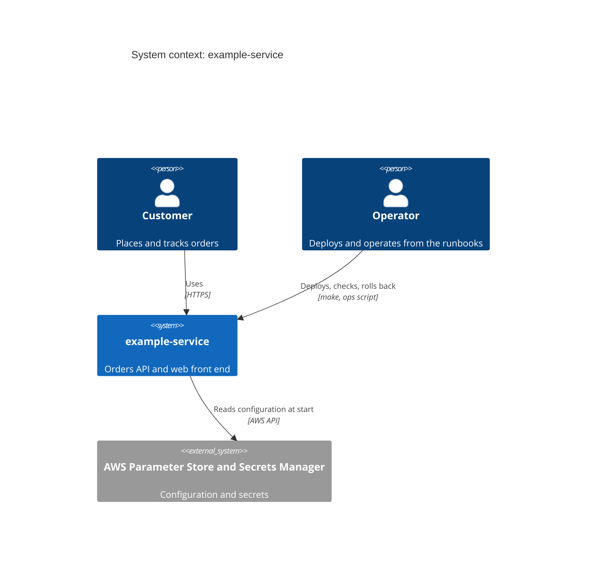
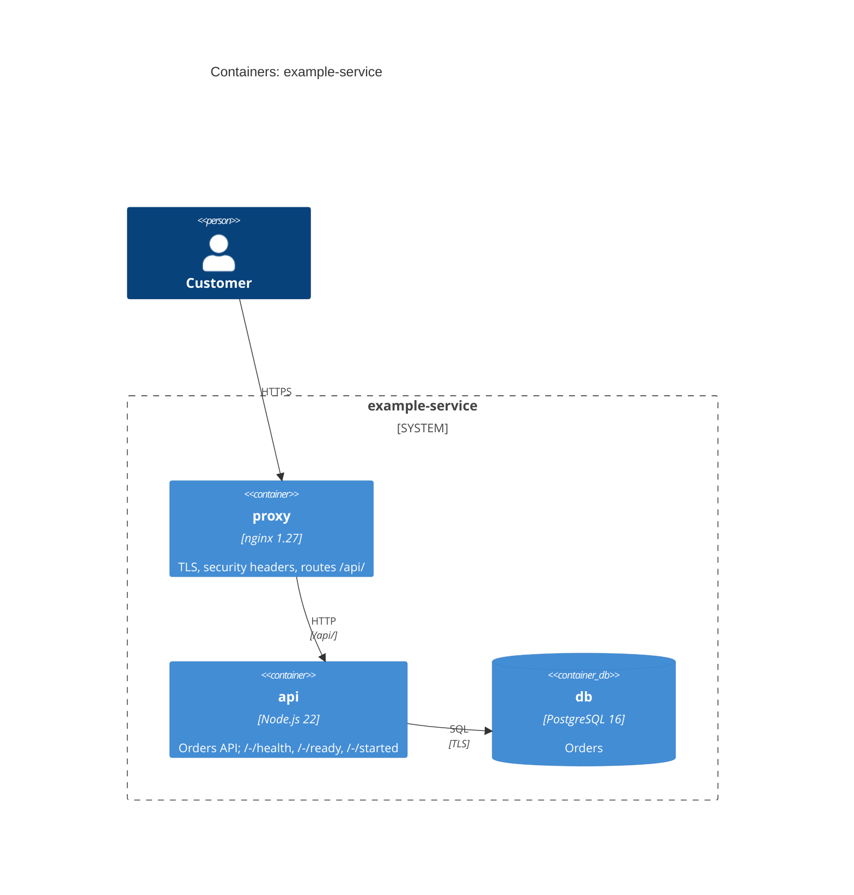
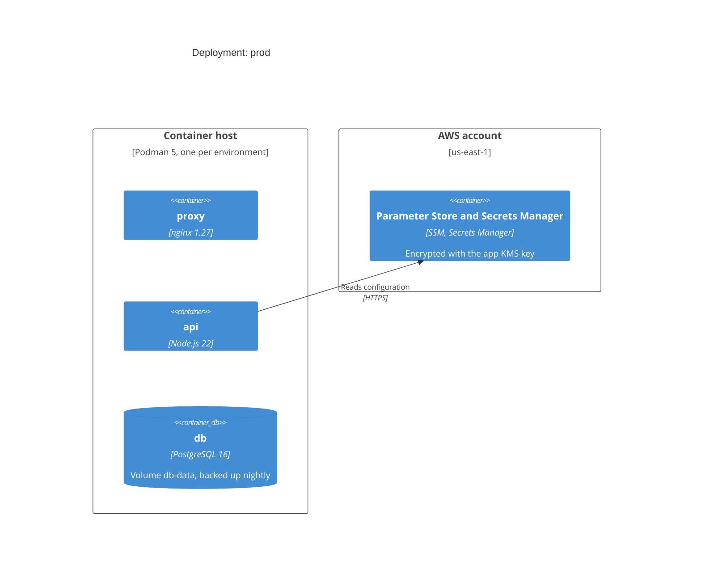

# Maintenance and Operations Manual: example-service

<!-- ascent-ops blueprint. ops-manuals adapts this worked example to the project:
every fact comes from the repository, and every section stays. Keep the front
matter current: as_of is the date of the last review, describes is the release or
commit this manual matches, sources are the files it documents. -->

## Overview

example-service is an orders API with a web front end. One proxy terminates TLS and routes `/api/` to the API; the API stores orders in PostgreSQL. It runs on one container host per environment, and its configuration lives in AWS Systems Manager Parameter Store and Secrets Manager.

| Fact | Value |
|---|---|
| Owner | the platform team (role, not a person) |
| Environments | dev, prod |
| Health endpoints | `/-/health` (liveness), `/-/ready` (readiness), `/-/started` (startup) |
| Infrastructure as code | `secure-parameters.yaml` (CloudFormation), `compose.yml` |
| Service levels | availability 99.5% monthly; p95 latency under 300 ms on `/api/orders` |

## Architecture diagrams

### System context

### Containers

### Deployment

## Dependency map

Built from the manifests; update it with every upgrade.

| Dependency | Kind | Version | Source | Update policy |
|---|---|---|---|---|
| nginx | base image | 1.27.2-alpine | `compose.yml` | monthly, with the security advisories |
| node | runtime | 22.11.0 | `compose.yml` | LTS minor releases monthly |
| postgres | database image | 16.4 | `compose.yml` | minor releases quarterly; a major upgrade needs an ADR |
| AWS Secrets Manager, SSM | managed service | n/a | `secure-parameters.yaml` | none |

## Environments

| Environment | Purpose | Host | Configuration path | Who can deploy |
|---|---|---|---|---|
| dev | integration and trials | dev container host | `/example-service/dev/` | any engineer |
| prod | customers | prod container host | `/example-service/prod/` | operators on the deploy rota |

Configuration is separated per environment by the `Environment` parameter; no value is shared between environments.

## Configuration and secrets

Infrastructure as code is the only way configuration changes: edit `secure-parameters.yaml`, deploy it, and record the change below. Nothing is changed by hand in the console; the weekly drift check (`ops-script-template.sh --check-drift`) reports any difference.

| Parameter | Where it lives | Secret? | Rotation | Notes |
|---|---|---|---|---|
| Environment | stack parameter | no | n/a | dev or prod |
| LogLevel | SSM `/example-service/<env>/log-level` | no | n/a | info by default |
| RotationLambdaArn | stack parameter | no | n/a | the rotation function for the database secret |
| DatabaseSecret | Secrets Manager `example-service/<env>/db` | yes | every 30 days | generated, never typed; encrypted with AppKey |

Secrets are never written to files, environment files or this manual. The API reads them at start from Secrets Manager; the ops script reads any operator secret with `read -rs`.

## Deploy

Run from a clean checkout of the release tag, using the deploy runbook.

1. **Pre-flight:** `ops-script-template.sh --env prod --dry-run` shows the change set and checks the AWS identity, a clean tree and the current health.
2. **Deploy:** `ops-script-template.sh --env prod` applies the stack and restarts the containers.
3. **Post-flight:** the script waits for `/-/ready`, then runs the smoke check. Stop and roll back if either fails.

## Rollback

`ops-script-template.sh --env prod --rollback` redeploys the previous release tag (recorded in the stack's `Release` tag). Database migrations are forward-compatible for one release, so a rollback needs no data change. A rollback is an ordinary documented operation: run it as soon as a post-flight check fails.

## Backup and restore

| What | How | When | Retention | Restore test |
|---|---|---|---|---|
| db volume | `pg_dump` to the encrypted backup bucket | nightly 02:00 UTC | 35 days | monthly, into dev |

Restore: stop the api container, restore the dump with `pg_restore --clean`, start the api, check `/-/ready`. The monthly restore test records its date in the change history.

## Scheduled maintenance

| Task | Cadence | Command | Expected result |
|---|---|---|---|
| Drift check | weekly | `ops-script-template.sh --env prod --check-drift` | no drift |
| Image updates | monthly | update the pinned versions, deploy to dev, then prod | post-flight passes |
| Restore test | monthly | restore the latest backup into dev | `/-/ready` returns 200 |
| Manual review | every 90 days, and after every release | `ops-manuals` (ascent-ops) | as_of updated |

## Upgrades

Upgrade one dependency at a time, in dev first. Pin the new version in the manifest, update the dependency map, deploy to dev, run the post-flight checks, then deploy to prod. A major version of PostgreSQL or Node.js needs an ADR.

## Access

| Access | Granted to | How | Review |
|---|---|---|---|
| Deploy (AWS role `example-service-deploy`) | operators on the deploy rota | SSO, short-lived credentials | quarterly |
| Read secrets | the api task role only | IAM policy on the one secret | on every change |
| Container hosts | operators | SSH certificates from the bastion | quarterly |

## Escalation and contacts

Contacts are roles and channels; names, phone numbers and email addresses live in the paging tool, never in this manual.

| Situation | First contact | Then |
|---|---|---|
| `/-/ready` failing in prod | on-call operator (paging rota) | platform team lead (paging rota) |
| Data loss or security concern | on-call operator | security on-call (→ ascent-security) |

## Change history

| Date | Release | Change | Manual sections updated |
|---|---|---|---|
| 2026-10-25 | v1.0.0 | First release of the manual | all |
